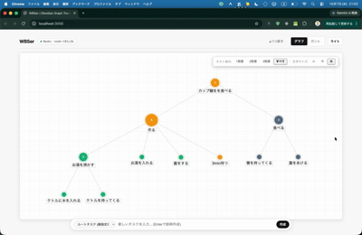
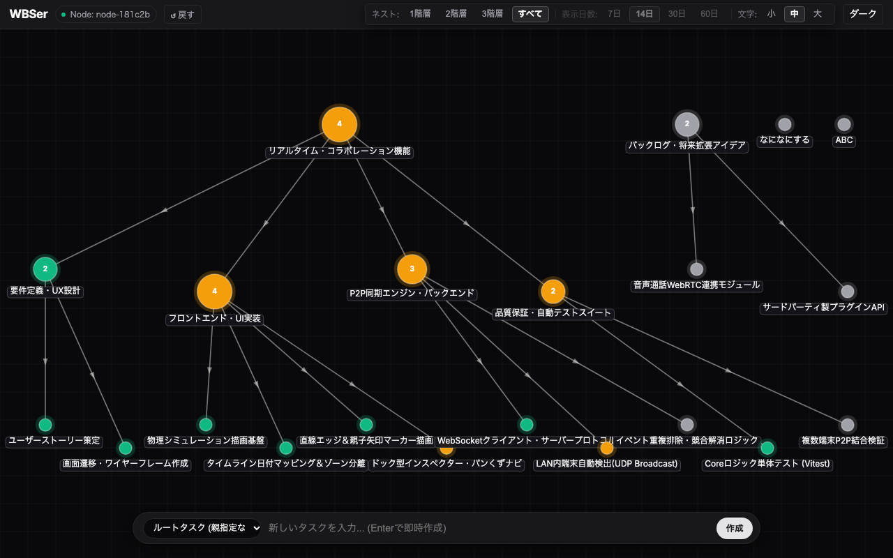
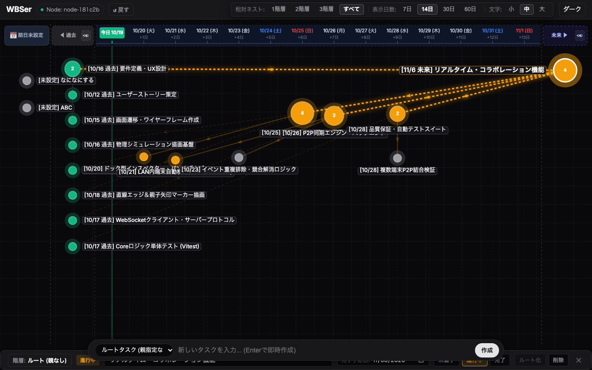

# WBSer - Local-First P2P Project Tracker



WBSer は、ローカル環境で完結するプロジェクト進行管理ツールです。
タスクの親子関係をノードグラフで俯瞰し、クリック操作で日付タイムライン上に展開してスケジュールを確認・調整できます。

外部サーバーやクラウドDBへの登録は不要で、単一バイナリやローカルファイル（JSONL）ベースで動作します。LAN内のファイル共有やWebSocketによるリアルタイム同期にも対応しています。

---

## 画面イメージと特徴

### 1. 全体グラフ表示
タスクの階層（WBS）と依存関係をグラフ構造で自動配置します。全体の進行状況やタスクのつながりをひと目で把握できます。



### 2. タイムライン表示（日付モード）
ノードをクリックすると、期日に応じた4つのゾーンにタスクが整列します。

- **期日未設定**: 左側の専用エリアに常駐
- **過去**: 期限を過ぎたタスクをまとめてスタック表示（トグルで表示/非表示切替）
- **タイムライン**: 本日・土日ハイライト付きの日次グリッド
- **未来**: 表示範囲外の未来タスクを右側に保持



ノードを日付列へドラッグ＆ドロップするだけで期日を直感的に変更できます。また、画面上部のドロップエリアにドラッグすると親タスクを解除してルートへ昇格できます。

### 3. 省電力設計
グラフの物理演算が静止すると描画ループ（`requestAnimationFrame`）が自動停止し、アイドル時の CPU 使用率は 0% になります。マウス操作やスクロールを検知した瞬間に即座に再開します。

---

## 操作方法

| 操作 | 内容 |
| :--- | :--- |
| **ノード クリック** | 下部インスペクターを開き、タイムライン表示へ切り替え |
| **ノード ダブルクリック** | 選択したタスクの配下（サブツリー）のみに絞り込み |
| **ノード ドラッグ** | カレンダー列へのドロップで期日変更 / 画面上端へドロップで親解除 |
| **キャンバス ドラッグ / ホイール** | タイムラインの横移動（過去・未来方向のスクロール） |
| **階層 (1 / 2 / 3 / すべて)** | 表示するツリーの深さを切り替え |
| **表示日数 (7 / 14 / 30 / 60日)** | タイムラインの表示範囲を変更 |
| **下部入力バー** | タスク名を入力して `Enter` で即時作成（親タスク指定可） |

---

## クイックスタート

### 開発環境での起動

Node.js 18 以上が必要です。

```bash
git clone https://github.com/kodai-n11qbb/WBS.git
cd WBS
npm install
npm run dev
```

ブラウザで `http://localhost:3000` を開きます。

### 対話型セットアップ
```bash
npm run setup
```
画面の案内に従って動作モード、データ保存先ディレクトリ、ポート番号を設定できます。

### 単一バイナリのビルド
```bash
npm run build:exe
```
`bin/` 配下に Node.js 不要で実行できるバイナリ（Windows用 `.exe` / macOS用実行ファイル）が出力されます。

---

## 動作モード

| モード | 説明 | 用途 |
| :--- | :--- | :--- |
| **`P2P`** | 共有ストレージやファイルサーバー上の同一データフォルダを参照 | 共有フォルダを使った複数人での作業 |
| **`HOST`** | 自身のPCをホストとして起動し、他端末からのWebSocket接続を受け付ける | リアルタイム共同編集の親機 |
| **`CLIENT`** | 起動中の HOST 端末のIPアドレスに接続 | 共同編集の子機 |

---

## データ管理

- **`data/state.json`**: 現在のタスク状態（ツリー構造、ステータス、期日）
- **`data/events.jsonl`**: 全ての変更履歴を追記記録するイベントログ
- `config.json` や CLI 引数 `--data-dir` で保存先フォルダを自由に変更できます。
- 個人データや作業ログがGitに混入しないよう、データファイルは `.gitignore` で保護されています。

---

## ドキュメント

詳しい設計内容やアーキテクチャについては [docs/index.md](./docs/index.md) を参照してください。
